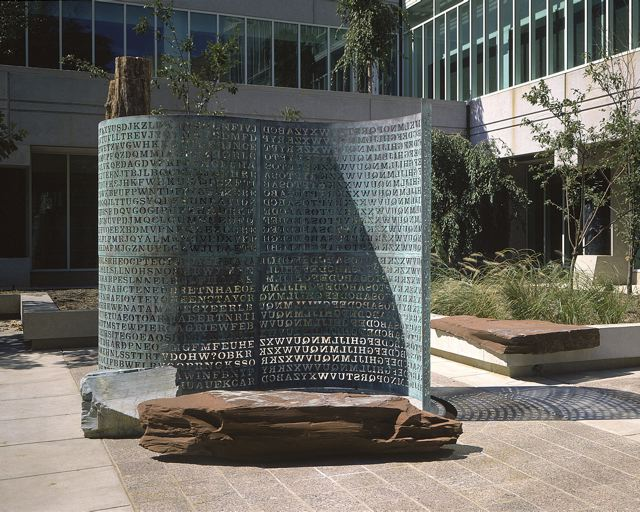

# Kryptos K4

**97 letters. A sculpture. A method still to recover.**



<sub>Image: Jim Sanborn, via Wikimedia Commons, [CC BY-SA 3.0](https://creativecommons.org/licenses/by-sa/3.0/). Reproduced without modification. [Source and credit](assets/CREDITS.md).</sub>

We're trying to recover the message **and the encryption method** behind the
fourth passage of Kryptos. This is the readable record of an ongoing
collaboration between Mark, Codex/Astra, Claude Code, Claude Online and Fable: historical
research, hand-cipher reasoning, computational experiments and independent checks.

**Project status — 11 October 2026:** no authenticated solution. We have ruled
out several precisely defined constructions and learned which promising-looking
fits are too flexible to be evidence. There is still no justified key and method
that explains all 97 letters.

| Start here | What you'll find |
| :--- | :--- |
| [What we've tried](WHAT_WE_TRIED.md) | Results grouped by idea, with the limits of each conclusion |
| [What's next](NEXT_STEPS.md) | Current work, open questions and priorities |
| [Evidence and method](EVIDENCE.md) | Sources, validation standards and pointers to the working archive |
| [The 97-letter input](data/k4.json) | Ciphertext and the four public plaintext clues |

## A puzzle built into a work of art

Jim Sanborn's Kryptos was dedicated at CIA headquarters in Virginia on
3 November 1990. Its most recognisable feature is a curling copper screen pierced
with letters. The wider installation includes stone, water, Morse inscriptions,
a compass rose and a lodestone. The CIA describes its theme as intelligence
gathering. [CIA account](https://www.cia.gov/legacy/headquarters/kryptos-sculpture/)

The encrypted text has four passages, usually called K1–K4. The first three
were deciphered in the 1990s. K4 is only 97 letters long, which makes it difficult:
there is little text to expose a pattern, and many invented systems can be made
to fit a short message. Earlier published research is an important starting
point for our work. [Richard Bean's research](https://kryptos.richardbean.id.au/)

There is a wrinkle in the story: in 2025, researchers recovered text from
archival material. Recovering words from an archive is different from deriving
the key and showing how those words became the carved ciphertext. Our objective
is that cryptographic explanation. [Account of the archival discovery](https://content.rrauction.com/kryptos-k4-discovered-not-solved-heres-what-actually-happened/)

Paradigm subsequently acquired the private archive and announced a system for
checking proposed answers. Its separate set of ten new puzzles is a different
challenge from the original K4. [Paradigm's announcement](https://www.paradigm.xyz/writing/kryptos)

## What we actually know

The public clues fix these plaintext letters at specific positions:

| Positions | Plaintext | Corresponding ciphertext |
| :--- | :--- | :--- |
| 22–25 | **EAST** | `FLRV` |
| 26–34 | **NORTHEAST** | `QQPRNGKSS` |
| 64–69 | **BERLIN** | `NYPVTT` |
| 70–74 | **CLOCK** | `MZFPK` |

Positions here start at **1**. Together these reveal 24 letters and leave 73
unknown. Spaces are not supplied by the ciphertext. The plaintext outline is:

```text
21 unknown | EASTNORTHEAST | 29 unknown | BERLINCLOCK | 23 unknown
```

The ciphertext, with its carved K4 row breaks, is:

```text
OBKR
UOXOGHULBSOLIFBBWFLRVQQPRNGKSSO
TWTQSJQSSEKZZWATJKLUDIAWINFBNYP
VTTMZFPKWGDKZXTJCDIGKUHUAUEKCAR
```

The preceding question mark belongs outside this 97-letter input.
[Ciphertext source](https://www.cia.gov/legacy/headquarters/kryptos-sculpture/)
· [Published crib analysis](https://ecp.ep.liu.se/index.php/histocrypt/article/download/153/109)

## Why we keep coming back to the clock

Sanborn's later clues identify Berlin's **World Clock at Alexanderplatz**.
Mark suggested taking its rotation seriously as a possible physical instruction.
That led us to test rotating alphabets, coupled wheels, city labels, compass
reading orders and procedures someone could perform with paper or a mechanical
device. These are hypotheses; the clock reference does not specify an algorithm.
[Sanborn's original letter](https://s3.documentcloud.org/documents/26229389/adobe-scan-nov-12-2025.pdf)

Historical detail matters. The clock's labels changed over time, and a museum
model differs from the full-size clock. We have compared dated photographs and
corrected transcription mistakes before using those readings in experiments.

## What would count as a solution?

A result must give us a coherent plaintext, an independently justified method
and key, exact re-encryption of **all 97 ciphertext letters**, and an independent
check. A recognisable phrase, a high English score or a custom key that merely
fits the known letters is not enough.

This repository keeps the story and the research decisions compact. The larger
working archive lives separately in the sibling `../kryptos` directory, with
source code, logs and detailed experiment records. The [evidence index](EVIDENCE.md)
explains how to find those records; they are not bundled into this summary repo.
